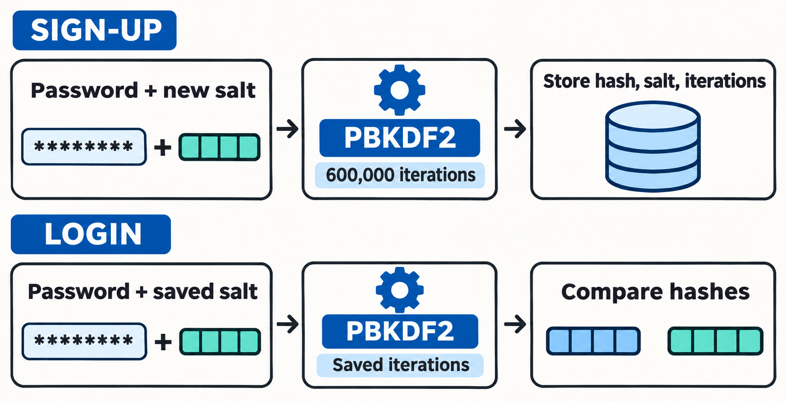
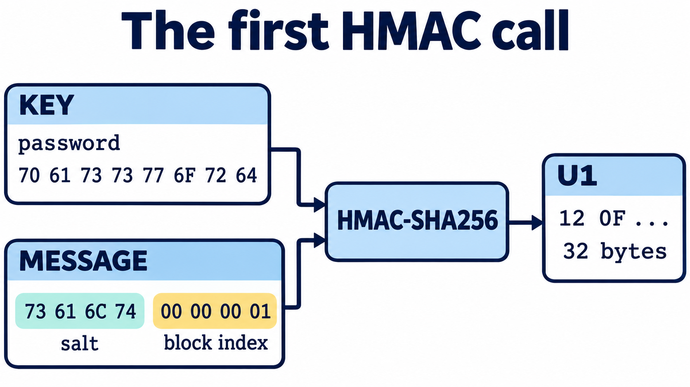
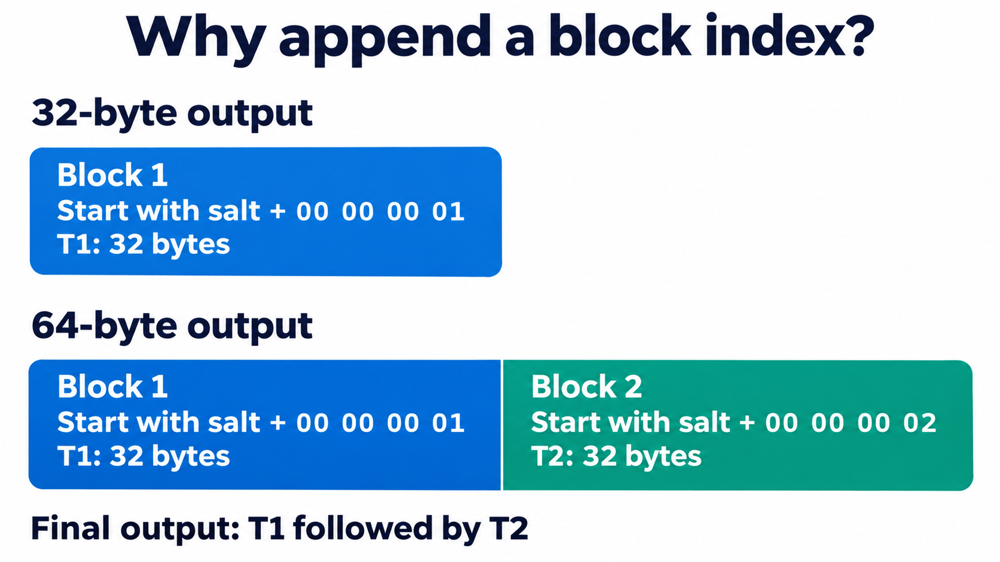
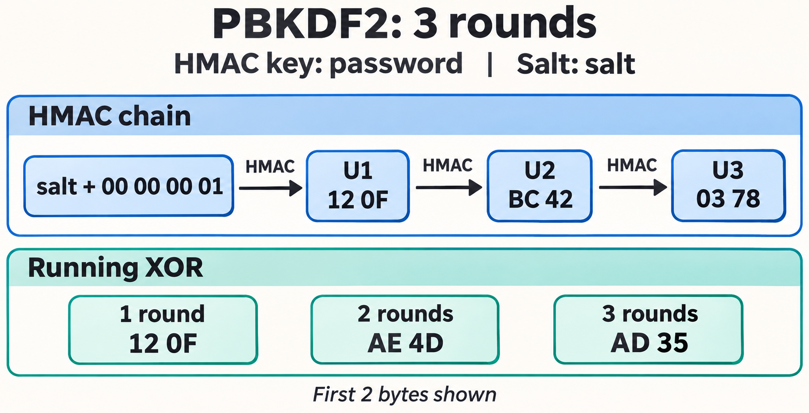

# 비밀번호 해시의 원리와 Java 코드 읽기

로그인할 때 서버는 **입력한 비밀번호를 가입 때와 같은 조건으로 다시 계산하고, 그 결과를 DB에 저장된 결과와 비교**합니다. 우리 프로젝트에서 그 계산을 맡는 클래스가 `PasswordHasher`입니다. 아래에서 해시, 솔트, 반복 횟수가 각각 왜 필요한지 살펴봅니다.

## 1. 해시는 어떤 값인가요?

해시 함수는 입력 데이터를 받아 정해진 길이의 결과를 만듭니다. 그 결과를 **해시값**이라고 합니다. 같은 함수에 같은 입력을 넣으면 같은 결과가 나옵니다. 암호학적 해시에서는 입력이 조금만 달라져도 결과가 크게 달라지도록 설계합니다. 결과만 가지고 원래 입력을 찾기는 어렵지만, 비밀번호 후보를 하나씩 넣어 결과를 맞춰 보는 것은 가능합니다.

| Java에서 자주 접하는 것 | 하는 일 | 예 |
| --- | --- | --- |
| 객체의 `hashCode()` | 객체를 빠르게 찾는 데 필요한 정수값을 계산합니다. | `HashMap`의 키 찾기 |
| 암호학적 해시 | 입력으로부터 정해진 길이의 해시값을 계산합니다. SHA-256은 빠르게 계산되도록 설계돼 있습니다. | 파일 변경 여부 확인 |
| 비밀번호용 계산 | 비밀번호와 솔트로부터 반복 계산을 거쳐 저장할 값을 만듭니다. 이 문서에서는 그 결과를 비밀번호 해시라고 부릅니다. | 이 프로젝트의 `PBKDF2WithHmacSHA256` |

DB에서 해시가 노출되더라도 원문 비밀번호를 바로 읽기 어렵게 만들려면, 비밀번호를 저장할 때는 후보를 대입할 때도 계산 비용이 드는 방식을 사용합니다. [OWASP 비밀번호 저장 안내](https://cheatsheetseries.owasp.org/cheatsheets/Password_Storage_Cheat_Sheet.html)

## 2. 솔트는 왜 함께 저장하나요?

**솔트(salt)**는 회원가입할 때 계정마다 생성하는 무작위 값입니다. 우리 코드에서는 `SecureRandom`으로 **16바이트**를 채웁니다. 두 회원이 같은 비밀번호를 쓰더라도 각자의 솔트를 넣으면 일반적으로 서로 다른 해시가 만들어집니다. 한 계정에 대해 미리 계산한 결과를 다른 계정에 그대로 쓰기도 어려워집니다.

로그인 때는 DB에 저장된 그 회원의 솔트를 다시 사용합니다. 같은 비밀번호에 **다른** 솔트를 넣으면 결과가 달라지기 때문에, 로그인할 때도 매번 새 솔트를 만들면 올바른 비밀번호를 확인할 수 없습니다. 솔트를 저장하는 이유가 여기에 있습니다. [RFC 8018의 솔트 설명](https://www.rfc-editor.org/rfc/rfc8018.html#section-4.1)



*위쪽은 회원가입이고 아래쪽은 로그인입니다. 마지막 칸에서는 로그인 때 만든 해시와 DB에서 읽은 해시를 비교합니다. 그림의 +는 비밀번호와 솔트가 함께 계산에 들어간다는 뜻입니다.*

## 3. 반복 횟수는 무엇이고 왜 필요한가요?

코드에서 본 `iterations`는 **PBKDF2가 내부 계산을 몇 번 수행할지 정하는 정수**입니다. 현재 코드는 `600_000`을 기본값으로 두고 있습니다. Java 숫자에서 밑줄은 읽기 편하게 넣은 구분 기호라서 값은 **600,000**입니다.

### 무엇을 반복하나요?

이 코드의 `PBKDF2WithHmacSHA256`은 내부적으로 **HMAC-SHA256**을 사용합니다. 비밀번호를 계산에 사용하는 키로 두고, 첫 계산에는 솔트와 블록 번호가 들어갑니다. 다음 계산부터는 바로 앞에서 나온 결과를 입력으로 사용합니다. PBKDF2는 이렇게 나온 중간 결과를 규칙에 따라 합칩니다. 이 코드처럼 **32바이트**를 얻을 때는 HMAC-SHA256 결과 크기와 같아서 블록 하나를 계산합니다. 그래서 `derive()`를 한 번 호출하면 Java가 내부에서 HMAC-SHA256을 실제로 60만 번 수행합니다. [RFC 8018의 PBKDF2 계산 절차](https://www.rfc-editor.org/rfc/rfc8018.html#section-5.2)

### 실제 숫자로 첫 3회 따라가기

예시 비밀번호로 `password`, 솔트로 `salt`를 사용합니다. 두 단어를 UTF-8로 바꾸면 아래에 보이는 바이트가 됩니다. 16진수 `70`처럼 **두 글자가 1바이트**입니다. 그림에 붙인 `U1`, `U2`, `U3`는 이번 계산에서 나온 32바이트짜리 중간 결과입니다.

#### 첫 번째 HMAC에는 어떤 값이 들어가나요?

HMAC-SHA256에는 **키**와 **메시지** 두 가지가 들어갑니다. 우리 예시에서 키는 비밀번호의 8바이트이고, 첫 메시지는 솔트의 4바이트 뒤에 블록 번호 4바이트를 붙인 8바이트입니다.



```text
키       password → 70 61 73 73 77 6F 72 64
메시지    salt     → 73 61 6C 74 00 00 00 01
                        솔트 4바이트 + 블록 번호 4바이트
HMAC 출력 U1      → 12 0F B6 CF … (전체 32바이트)
```

그림의 `MESSAGE`는 여기서 **HMAC이 처리하는 바이트 배열**을 뜻합니다. Java의 HMAC API에 대응시키면 `Mac.init(키)`에 비밀번호로 만든 키를 넣고, `Mac.doFinal(메시지)`에 처리할 바이트를 넣는 구조입니다. 현재 `PasswordHasher`에서는 JDK의 PBKDF2 구현이 이 작업을 수행합니다. [Java 21 Mac API](https://docs.oracle.com/en/java/javase/21/docs/api/java.base/javax/crypto/Mac.html)

#### `00 00 00 01`은 왜 솔트 뒤에 붙나요?

`00 00 00 01`은 **출력 블록 번호 1을 4바이트로 적은 값**입니다. PBKDF2는 번호 1부터 시작하고, 숫자의 큰 자리부터 먼저 적습니다. 이를 **빅엔디언**이라고 합니다. 번호 2는 `00 00 00 02`이고, 번호 256은 `00 00 01 00`입니다. 블록의 첫 메시지를 만들 때 솔트 뒤에 이 **4개의 바이트를 순서대로 이어 붙입니다**. [RFC 8018의 블록 번호 정의](https://www.rfc-editor.org/rfc/rfc8018.html#section-5.2)

여기서 **블록 하나는 최종 출력에 들어갈 32바이트 조각**입니다. 64바이트가 필요하다고 가정하면 32바이트 조각을 두 개 만들면 됩니다. 같은 비밀번호와 솔트로 두 블록의 계산을 시작하면 같은 결과를 두 번 얻게 되므로, **블록마다 첫 메시지가 달라지도록 번호를 붙입니다.** 블록 1과 블록 2는 각각의 첫 메시지에서 시작하고, 계산이 끝나면 두 결과를 순서대로 잇습니다. [RFC 8018의 출력 조합 규칙](https://www.rfc-editor.org/rfc/rfc8018.html#section-5.2)



| 하나씩 세는 값 | 무엇을 세나요? | 현재 코드에서 |
| --- | --- | --- |
| 블록 번호 | 출력에 쓸 32바이트 조각이 몇 번째인지 셉니다. | 256비트(32바이트) 결과를 요청하므로 블록 **1번**을 사용합니다. |
| 반복 횟수 | 그 블록 안에서 HMAC을 몇 번 계산할지 정합니다. | 블록 1번 안에서 HMAC을 **600,000회** 수행합니다. |

#### 2회와 3회에는 무엇을 다시 넣나요?

HMAC의 키는 매번 같은 `password` 바이트입니다. **2회부터는 직전 HMAC 출력 32바이트 전체를 이번 메시지로 사용합니다.** 즉 2회에 들어가는 메시지는 `U1` 전체이고, 3회에 들어가는 메시지는 `U2` 전체입니다.



| 회차 | 이번 HMAC에 넣는 메시지 | 이번에 새로 나온 값의 앞 2바이트 | 여기서 멈추면 반환되는 값의 앞 2바이트 |
| --- | --- | --- | --- |
| 1회 | `73 61 6C 74 00 00 00 01` | `U1 = 12 0F …` | `U1 = 12 0F …` |
| 2회 | `U1 전체 32바이트` | `U2 = BC 42 …` | `U1 XOR U2 = AE 4D …` |
| 3회 | `U2 전체 32바이트` | `U3 = 03 78 …` | `U1 XOR U2 XOR U3 = AD 35 …` |

**XOR**는 두 값의 비트를 자리별로 비교해 같으면 0, 다르면 1을 만드는 계산입니다. `U1`의 첫 바이트 `12`와 `U2`의 첫 바이트 `BC`를 XOR하면 `AE`가 됩니다. 거기에 `U3`의 첫 바이트 `03`을 XOR하면 `AD`가 됩니다. 실제로는 32바이트 전체에서 같은 방식으로 계산합니다.

**2회에서 3회로 늘려도 `U1`과 `U2`는 그대로예요.** 달라지는 건 `U3`까지 합친 뒤 돌려주는 값입니다. 그래서 가입 때 2회로 만든 값 `AE 4D …`를 저장하고 로그인 때 3회로 계산하면 `AD 35 …`가 나와서 비교에 실패합니다. 60만 회에서 70만 회로 바꿀 때도 같은 원리가 적용됩니다. [RFC 8018의 중간값 계산과 결합 규칙](https://www.rfc-editor.org/rfc/rfc8018.html#section-5.2)

<details>
<summary>실제 HMAC 입력·출력의 전체 바이트 펼쳐 보기</summary>

모든 회차에서 사용한 키는 `70 61 73 73 77 6F 72 64`입니다. 아래 두 줄로 나뉜 값은 읽기 편하게 줄을 나눈 하나의 32바이트 배열입니다. 앞 회차의 출력과 다음 회차의 입력이 일치하는지 확인해 보세요.

```text
1회
입력   = 73 61 6C 74 00 00 00 01
출력 U1 = 12 0F B6 CF FC F8 B3 2C 43 E7 22 52 56 C4 F8 37
         A8 65 48 C9 2C CC 35 48 08 05 98 7C B7 0B E1 7B

2회
입력   = 12 0F B6 CF FC F8 B3 2C 43 E7 22 52 56 C4 F8 37
         A8 65 48 C9 2C CC 35 48 08 05 98 7C B7 0B E1 7B
출력 U2 = BC 42 BA 5A 53 93 F5 FF 6E ED FD AB 7E 34 95 E7
         82 55 77 47 DF 0E 64 97 DE E7 40 26 22 4C AD 38

3회
입력   = BC 42 BA 5A 53 93 F5 FF 6E ED FD AB 7E 34 95 E7
         82 55 77 47 DF 0E 64 97 DE E7 40 26 22 4C AD 38
출력 U3 = 03 78 28 9F 69 E8 B8 6C 82 36 0B 64 AC A4 1E 2B
         91 9A 1B B9 06 3A 7C 85 97 B8 38 50 52 2B 27 BF
```

</details>

<details>
<summary>각 횟수로 계산한 전체 결과 32바이트</summary>

```text
1회  120FB6CFFCF8B32C43E7225256C4F837A86548C92CCC35480805987CB70BE17B
2회  AE4D0C95AF6B46D32D0ADFF928F06DD02A303F8EF3C251DFD6E2D85A95474C43
3회  AD35240AC683FEBFAF3CD49D845473FBBBAA2437F5F82D5A415AE00AC76C6BFC
```

</details>

### 왜 하필 이렇게 여러 번 계산하나요?

누군가 DB에서 **저장된 해시와 솔트**를 가져갔다고 생각해 보세요. 비밀번호를 알아내려면 후보 하나를 넣어 해시를 다시 계산한 뒤, 저장된 해시와 같은지 확인해야 합니다. **이 확인을 후보마다 새로 해야 해요.**

| 비밀번호 후보 하나를 확인할 때 | 후보 1,000개를 확인하는 데 필요한 내부 계산 |
| --- | ---: |
| 1회 계산 | 1,000회 |
| 600,000회 계산 | 600,000 × 1,000 = **6억 회** |

사용자가 로그인할 때는 보통 비밀번호 하나를 확인합니다. 많은 후보를 대입하는 쪽은 후보 하나를 확인할 때마다 60만 회를 부담합니다. 이렇게 **한 번 추측하는 데 드는 비용을 높이는 것**이 반복 계산의 목적입니다.

반복 횟수를 늘리면 정상 로그인도 느려지므로 서버 응답 시간과 처리량을 함께 고려합니다. 이 프로젝트의 600,000회는 OWASP가 PBKDF2-HMAC-SHA256에 제시하는 반복 횟수와 같습니다. [OWASP의 PBKDF2 반복 횟수 안내](https://cheatsheetseries.owasp.org/cheatsheets/Password_Storage_Cheat_Sheet.html#pbkdf2)

### 가입할 때 쓴 횟수를 왜 DB에도 넣나요?

나중에 새로 가입하는 회원의 기본값을 **700,000**으로 바꾼다고 가정해 보세요. 이미 **600,000**으로 계산해 저장한 회원에게 로그인 때 **700,000**을 적용하면, 올바른 비밀번호를 입력해도 저장된 결과와 맞지 않습니다.

| 회원 | 가입 때 사용한 횟수 | 로그인 때 사용할 횟수 |
| --- | ---: | ---: |
| 기존 회원 | 600,000 | 그 회원의 DB 값 600,000 |
| 설정 변경 후 가입한 회원 | 700,000 | 그 회원의 DB 값 700,000 |

그래서 가입 코드는 기본값 `PasswordHasher.ITERATIONS`를 사용해 계산하고, 로그인 코드는 **조회한 회원의 `iterations`**를 넘기는 구조로 연결합니다. 지금 `derive()`가 반복 횟수를 매개변수로 받는 이유입니다. [현재 PasswordHasher](../../../cinema/src/main/java/cinema/server/auth/PasswordHasher.java#L11) · [현재 MemberDao](../../../cinema/src/main/java/cinema/server/auth/MemberDao.java#L81)

## 4. Java에서는 어떤 라이브러리를 쓰나요?

이 프로젝트는 **JDK에 들어 있는 표준 암호 API**를 사용합니다. 이 기능을 위해 Maven에 별도 라이브러리를 추가할 필요가 없습니다. `PBKDF2WithHmacSHA256`은 알고리즘 이름이고, `SecretKeyFactory`는 Java에서 그 알고리즘 구현을 찾아 사용하는 API입니다. [Oracle JDK 21 암호 제공자 문서](https://docs.oracle.com/en/java/javase/21/security/oracle-providers.html) · [Java 21 SecretKeyFactory](https://docs.oracle.com/en/java/javase/21/docs/api/java.base/javax/crypto/SecretKeyFactory.html)

| API | 현재 코드에서 하는 일 |
| --- | --- |
| `java.security.SecureRandom` | 예측하기 어려운 바이트를 만들고 솔트 배열을 채웁니다. |
| `javax.crypto.spec.PBEKeySpec` | 비밀번호 문자 배열, 솔트, 반복 횟수, 결과 길이(비트)를 하나의 입력 명세로 묶습니다. |
| `javax.crypto.SecretKeyFactory` | 알고리즘 이름으로 구현을 선택하고, 입력 명세를 넘겨 결과를 계산합니다. |
| `java.util.Arrays.fill()` | 계산이 끝나면 코드에서 만든 비밀번호 문자 배열을 덮어씁니다. |

## 5. 현재 `PasswordHasher.java` 읽기

Eclipse에서 `cinema → src/main/java → cinema.server.auth → PasswordHasher.java`를 열면 됩니다. 이 클래스는 `newSalt()`로 솔트를 만들고, `derive()`로 비밀번호에 해당하는 바이트 배열을 계산합니다. [현재 PasswordHasher.java](../../../cinema/src/main/java/cinema/server/auth/PasswordHasher.java)

### `newSalt()`에서 16바이트 만들기

```java
byte[] newSalt() {
    byte[] salt = new byte[16];
    random.nextBytes(salt);
    return salt;
}
```

`new byte[16]`은 값이 0인 바이트 16개를 준비합니다. 바로 다음 줄의 `random.nextBytes(salt)`가 그 자리를 무작위 값으로 채웁니다. 반환한 배열은 가입 때 해시 계산에 사용하고 DB에도 함께 저장할 값입니다. [Java 21 SecureRandom](https://docs.oracle.com/en/java/javase/21/docs/api/java.base/java/security/SecureRandom.html)

### `derive()`에서 계산하고 문자 배열 정리하기

아래는 현재 코드에서 주석을 접어 읽은 모습입니다.

```java
byte[] derive(String password, byte[] salt, int iterations)
        throws GeneralSecurityException {
    char[] chars = password.toCharArray();
    PBEKeySpec spec = new PBEKeySpec(chars, salt, iterations, 256);
    try {
        return SecretKeyFactory.getInstance("PBKDF2WithHmacSHA256")
                .generateSecret(spec).getEncoded();
    } finally {
        spec.clearPassword();
        Arrays.fill(chars, '\0');
    }
}
```

1. **`toCharArray()`**로 비밀번호의 작업용 문자 배열을 만듭니다.
2. **`new PBEKeySpec(..., 256)`**으로 네 가지 계산 조건을 묶습니다. 마지막 값은 **256비트**, 즉 **32바이트**를 요청한다는 뜻입니다.
3. **`getInstance().generateSecret().getEncoded()`** 순서로 알고리즘을 찾고 계산한 뒤, 결과를 `byte[]`로 꺼냅니다. DB에도 이 바이트 배열이 들어갑니다.
4. **`finally`**는 알고리즘 선택이나 계산이 실패해도, `try`에 들어간 뒤라면 실행됩니다. `clearPassword()`는 입력 명세 안의 복사본을 지우고, `Arrays.fill(chars, '\0')`는 메서드가 만든 문자 배열을 덮어씁니다. 처음 받은 `String password`는 불변 객체여서 이 코드로 덮어쓸 수 없습니다. [Java 21 PBEKeySpec](https://docs.oracle.com/en/java/javase/21/docs/api/java.base/javax/crypto/spec/PBEKeySpec.html)

## 6. 지금 DB 코드와 어디서 만나나요?

현재 `MemberDao`에는 회원을 INSERT하는 `insert()`와 이메일로 조회하는 `findByEmail()`이 있습니다. `PasswordHasher`와 회원 저장·조회는 각각 준비돼 있고, 아래는 두 코드를 회원가입·로그인 서비스에서 이어 붙일 때의 흐름입니다. [현재 MemberDao.java](../../../cinema/src/main/java/cinema/server/auth/MemberDao.java)

| 단계 | 이어질 호출 | DB에서 쓰는 값 |
| --- | --- | --- |
| 회원가입 | `newSalt()` → `derive(입력 비밀번호, 새 솔트, 기본 반복 횟수)` → `MemberDao.insert(...)` | `password_salt`, `password_hash`, `password_iterations`를 저장합니다. |
| 로그인 | `MemberDao.findByEmail(...)` → `derive(입력 비밀번호, 저장된 솔트, 저장된 반복 횟수)` → 해시 비교 | 저장한 세 값을 읽습니다. |

연결 코드에서는 `MessageDigest.isEqual(저장된해시, 다시계산한해시)`로 두 바이트 배열의 **내용**이 같은지 확인할 수 있습니다. 배열에 `==`를 쓰면 같은 배열 객체인지 비교합니다. [Java 21 MessageDigest.isEqual()](https://docs.oracle.com/en/java/javase/21/docs/api/java.base/java/security/MessageDigest.html#isEqual(byte%5B%5D,byte%5B%5D))

## 이해 확인

- **같은 비밀번호로 가입한 두 사람의 해시를 다르게 만드는 것은?** 계정마다 새로 생성한 솔트입니다.
- **PBKDF2 계산을 일부러 오래 걸리게 하는 것은?** 비밀번호 후보마다 부담해야 하는 반복 계산입니다.
- **가입 기본값이 바뀌어도 기존 회원이 로그인하려면?** 그 회원의 솔트와 가입 당시 반복 횟수를 DB에서 읽어 다시 계산합니다.

<details>
<summary>그림 생성 프롬프트</summary>

기본 이미지 생성 도구로 만든 그림입니다.

Use case: scientific-educational. Create one wide landscape, highly legible textbook infographic for a Korean beginner learning Java password hashing. Off-white background, restrained charcoal type and contrasting blue and teal, crisp editorial vector-like illustrations, large labels, no decoration or long sentences. Use two horizontal rows, three evenly spaced stages per row, left to right. Top row title "SIGN-UP". Stage 1 is a masked password input and a small random-byte tile, labeled "Password + new salt". A single right arrow to stage 2 labeled "PBKDF2", with a small secondary label "600,000 iterations". A single right arrow to stage 3, a database cylinder labeled "Store hash, salt, iterations". Bottom row title "LOGIN". Stage 1 is a masked password input and a previously stored byte tile, labeled "Password + saved salt". A single right arrow to stage 2 labeled "PBKDF2", with secondary label "Saved iterations". A single right arrow to stage 3 labeled "Compare hashes", showing two byte tiles side by side inside the comparison card. Use the exact English labels above, no extra labels, no passwords in plaintext, no example hash strings, no padlock or reversible arrows. High contrast with margins so it remains readable embedded in Markdown.

**PBKDF2 첫 3회 그림**

Create a wide, two-band textbook infographic with crisp large readable type on an off-white background, charcoal text and restrained blue and teal, same educational visual style as a simple computing textbook. Subject: a real PBKDF2-HMAC-SHA256 three-round example. Print all given hex byte pairs exactly. Heading "PBKDF2: 3 rounds". Subheading "HMAC key: password   |   Salt: salt", with password and salt shown as literal example words. Upper band labeled "HMAC chain". Show four boxes in a strictly left-to-right chain, connected only by three simple right-pointing arrows. Box texts from left to right exactly: "salt + 00 00 00 01"; "U1" above "12 0F"; "U2" above "BC 42"; "U3" above "03 78". Label each of these three arrows "HMAC". Below this chain, use a clearly separate lower band labeled "Running XOR", with three horizontally aligned cards: "1 round" above "12 0F"; "2 rounds" above "AE 4D"; "3 rounds" above "AD 35". Use a small footer "First 2 bytes shown". The upper band is a dependency chain and the lower band is three output checkpoints; do not draw arrows in the lower band. Avoid extra text, extra boxes, byte pairs, or values. Use generous spacing and verify that the byte pairs use zero in 0F and 03.

**첫 HMAC 입력 그림**

Create one wide 16:9 textbook infographic on a white background. Navy typography, pale-blue password key, pale-teal salt bytes, warm-yellow counter bytes. Large type and precise monospace hex. Title "The first HMAC call". Composition: two distinct input cards on the left each with one arrow converging into a box labeled "HMAC-SHA256", then one arrow to a right output card. The TOP input card is labeled "KEY" and shows the exact separate lines "password" and "70 61 73 73 77 6F 72 64". The BOTTOM input card is labeled "MESSAGE" and contains two adjacent colored byte groups in this exact order, "73 61 6C 74" with caption "salt", then "00 00 00 01" with caption "block index". Both byte groups are one message going into HMAC, distinct from the key. Output card shows exact label "U1" and text "12 0F ..." and "32 bytes". No extra arrows, no code, no additional numbers or padding, no text other than the specified labels. Labels and hex must all be sharp and verbatim.

**출력 블록 번호 그림**

Create one wide 16:9 educational infographic called "Why append a block index?" Clean white background, navy type, blue and teal cards, wide margins, large readable text. It has two clearly separated horizontal rows. Upper row label "32-byte output" and below it exactly one left-aligned blue card reading "Block 1" on the first line, "Start with salt + 00 00 00 01" on the second line, "T1: 32 bytes" on the third line. Lower row label "64-byte output" and below it exactly two adjacent cards with a visible central separator. The left card must be identical to the upper card, including byte values and T1. The right card is teal and reads "Block 2" on the first line, "Start with salt + 00 00 00 02" on the second line, "T2: 32 bytes" on the third line. Under the lower row write "Final output: T1 followed by T2". Keep the counter bytes monospace and exact. Do not put any arrows between T1 and T2: these two blocks are each computed from their own salt-plus-index message. No other text, icons or numbers.

</details>
